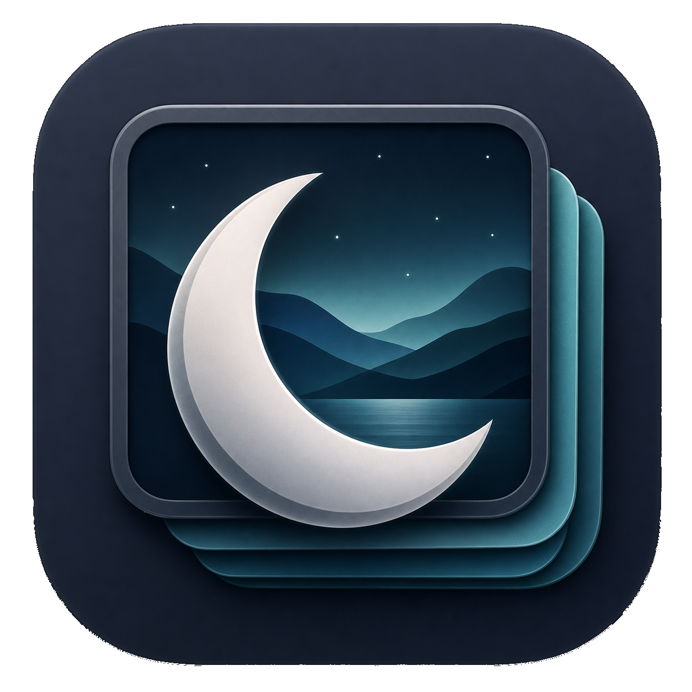
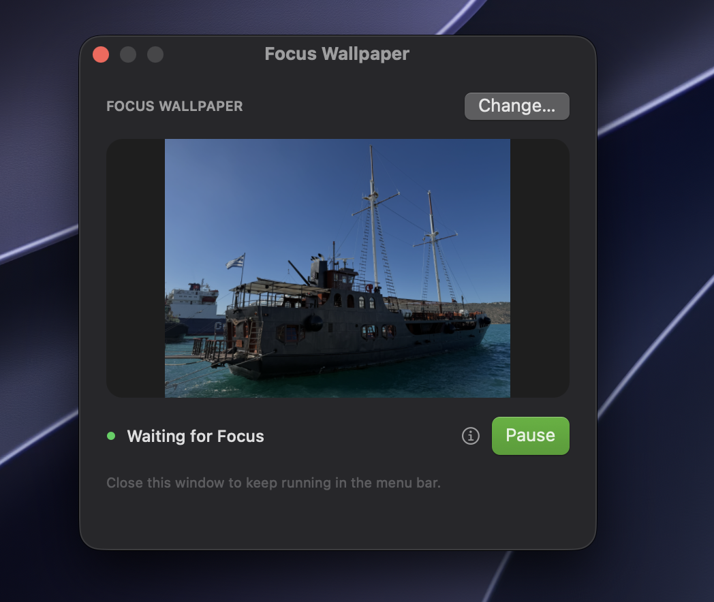
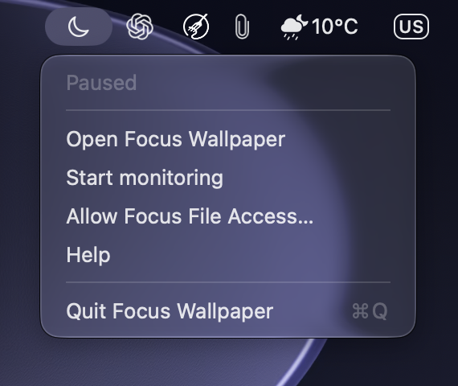

<p align="center">
  
</p>

<h1 align="center">Focus Wallpaper</h1>

<p align="center">A different desktop when it’s time to focus.</p>

<p align="center">
  <a href="https://rafref99.github.io/FocusWallpaper/">Website</a> ·
  <a href="https://github.com/rafref99/FocusWallpaper/raw/refs/heads/main/dist/FocusWallpaper.dmg">Download for Mac</a> ·
  <a href="https://github.com/rafref99/FocusWallpaper/issues">Report an issue</a>
</p>

Focus Wallpaper is a small macOS menu-bar app that displays your chosen image while a Focus mode is active. When Focus ends, your original wallpaper is revealed. Close the window and let it run from the moon icon in your menu bar—without a Dock icon, Shortcut, or LaunchAgent.

<p align="center">
  
</p>

## What it does

- **One image for Focus.** Choose a picture and use it whenever a Focus mode is on.
- **Keeps your original wallpaper.** Your macOS wallpaper settings are never overwritten, including aerial and dynamic selections.
- **Stays in the menu bar.** Close the window while monitoring continues. Pause or quit whenever you like.
- **Works locally.** No accounts, analytics, uploads, or network service.

## Install

[Download FocusWallpaper.dmg](https://github.com/rafref99/FocusWallpaper/raw/refs/heads/main/dist/FocusWallpaper.dmg), open it, and drag **Focus Wallpaper** into **Applications**.

The included download is for **Apple silicon Macs**. The project targets **macOS 12 or later**, but Focus detection depends on an undocumented macOS file format; support may vary with macOS releases. The app is signed ad hoc, not notarized, so macOS may require approval on first launch. You can also [build from source](#build-from-source).

## Get started

1. Open the app and choose your Focus image.
2. Click **Start**, then turn on a Focus mode in macOS.
3. Close the window if you like. Monitoring continues from the moon icon.
4. Turn Focus off to reveal your original wallpaper. **Pause** and **Quit Focus Wallpaper** also remove the Focus image immediately.

<p align="center">
  
</p>

### Allowing Focus access

If the app reports an access problem, pause monitoring and select **Allow Focus File Access…** from the moon menu. Choose your `~/Library/DoNotDisturb/DB` folder. In the folder picker, press **⌘⇧G** to enter that path if needed. Access is remembered for future launches.

Some macOS versions may still require **System Settings → Privacy & Security → Full Disk Access** for the app. This permission is broader than the single file the app reads; enable it only if folder access is insufficient and you are comfortable granting it. Reopen the app after changing the permission.

You do not need to enable Share Focus Status or create a Shortcut. Monitoring starts only after you click **Start** each time you launch the app.

## How it works

The app checks the local Focus state about every two seconds. While Focus is on, it displays a temporary, click-through image behind desktop icons and application windows. Removing that image reveals the wallpaper already managed by macOS. The lock-screen wallpaper and macOS Wallpaper settings remain unchanged.

Focus detection reads `~/Library/DoNotDisturb/DB/Assertions.json`, currently supporting the version-8 format. Apple does not document this format, so macOS updates may require an app update. Unreadable or unfamiliar data is reported as unavailable, never assumed to mean Focus is off.

### Current scope

- One image is shared by all Focus modes; there are no per-mode assignments.
- The image fills each display and is cropped proportionally to fit.
- Space changes, multiple displays, Stage Manager, and fullscreen behavior can vary by macOS version.
- Automatic schedules and Focus changes synced from other devices may be delayed and need verification on your system.

## Build from source

Use Xcode with a Swift 6-compatible toolchain on macOS.

```sh
git clone https://github.com/rafref99/FocusWallpaper.git
cd FocusWallpaper
scripts/package_app.sh
```

The app is created at `dist/FocusWallpaper.app`. The build uses your selected toolchain and architecture; the included download is an arm64 build. If needed, select Xcode explicitly:

```sh
DEVELOPER_DIR=/Applications/Xcode.app/Contents/Developer scripts/package_app.sh
```

Run the tests or create a disk image:

```sh
swift test
scripts/package_dmg.sh --skip-build
```

The version is stored in [`VERSION`](VERSION). Packaging uses an ad-hoc signature; Developer ID signing and notarization are not configured.

<details>
<summary>Maintaining the GitHub Pages website</summary>

The showcase is a static [`index.html`](index.html) at the repository root. It uses the two screenshots in `Resources/` and links to `dist/FocusWallpaper.dmg`. No frontend build or external assets are required.

For branch-based GitHub Pages, select **Deploy from a branch → main → / (root)** in the repository’s **Settings → Pages**. The `.nojekyll` file keeps the site static. Commit the updated DMG along with the site when publishing a new download; do not commit build caches or DMG staging files. See [GitHub’s Pages setup guide](https://docs.github.com/en/pages/getting-started-with-github-pages/configuring-a-publishing-source-for-your-github-pages-site).

Preview locally with `python3 -m http.server 8000`, then visit `http://localhost:8000`.

</details>

<details>
<summary>Upgrading from the old Shortcut-based version</summary>

The app removes its old `local.focus-wallpaper-sync` and `local.focus-wallpaper` LaunchAgents at startup. Legacy URL triggers, command-line switching, normal-wallpaper presets, and login controls are retired. Remove any personal automations you previously created for the app.

If an older version already replaced your preferred wallpaper, select it once in macOS Wallpaper settings. This version leaves that selection untouched and does not apply the older URL-only recovery records.

</details>

## Privacy & contributions

Images are copied to `~/Library/Application Support/FocusWallpaper/Images`. Preferences and file-access bookmarks stay on your Mac. The app reads the Focus assertion file but never edits it.

Bug reports and contributions are welcome. When [opening an issue](https://github.com/rafref99/FocusWallpaper/issues), include your macOS version, Mac architecture, and steps to reproduce. Avoid posting personal file contents or unredacted diagnostics.

## License

[MIT](LICENSE) · Created by [Rafael Refaiya](https://github.com/rafref99).
